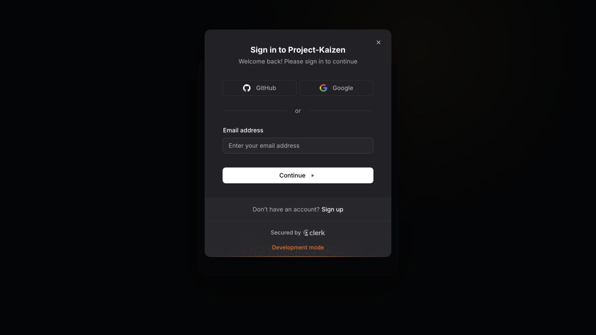
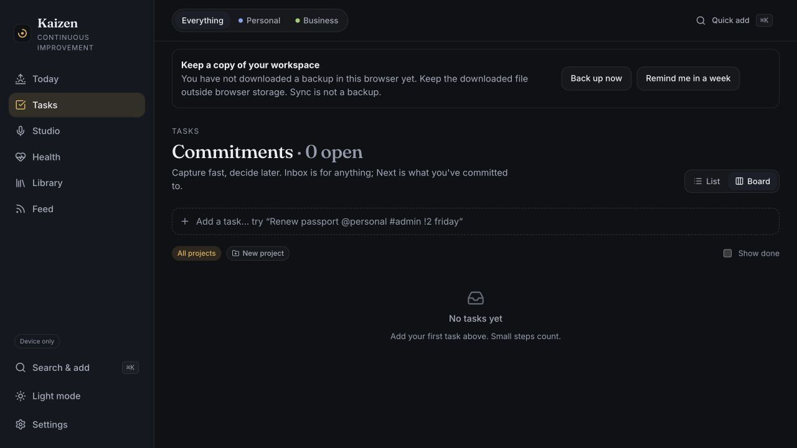
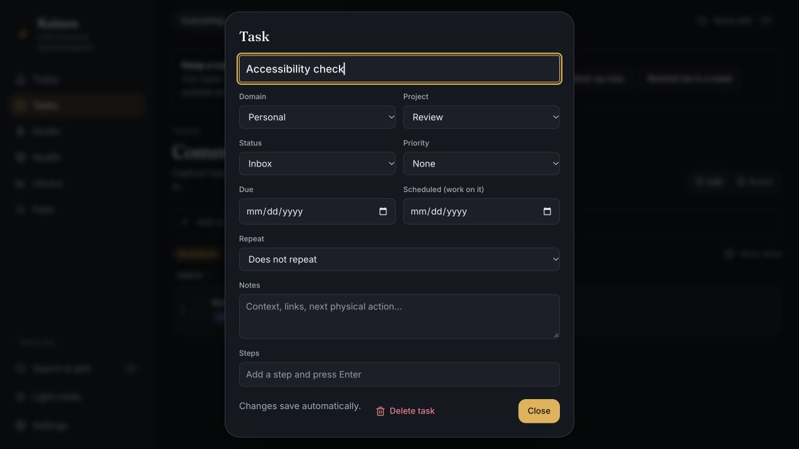
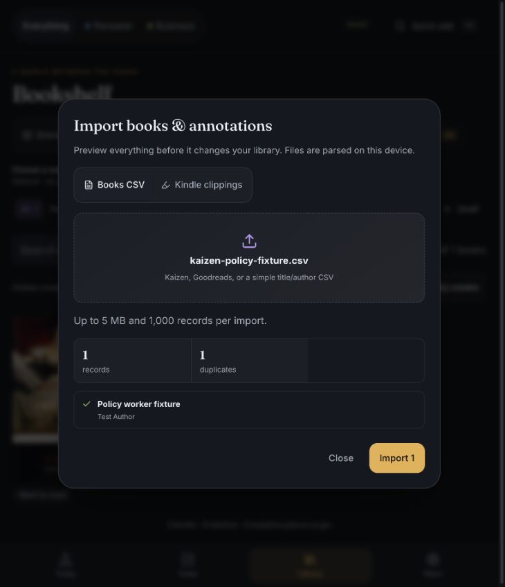
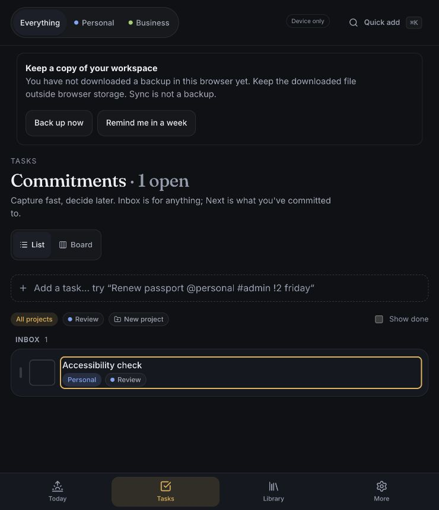

# Remaining accessibility and release checks

Review ID: **REV-2026-10-22-REMAINING-CHECKS** · Issues [#8](https://github.com/calcuttin/Project-Kaizen/issues/8) and [#18](https://github.com/calcuttin/Project-Kaizen/issues/18).

AI-assisted verification and fixes by Codex at the maintainer’s request, 2026-10-22 America/New_York. Live feature checks used release `236a8172d153a7340ce3f7a6d931a5588052ec46` and one newly created disposable development account. Accessibility fixes were exercised against the local branch based on that revision. This record distinguishes observed behavior, automated checks, and remaining manual work; it does not claim full accessibility compliance or production certification.

## Captured steps and findings

1. **Live sign-in — passed within the configured development instance.** The sign-in modal rendered and email-code sign-in completed. A synthetic task reached “Saved.” No CSP errors were recorded in the browser console; the expected development-key warning remained. This is not a test of a separate production identity instance or custom auth domain.

   

2. **Task view selection — confirmed accessibility defect, fixed.** The selected List/Board control changed visually but the accessibility tree exposed neither selection state. The shared segmented control now has `aria-pressed`. Life-lens filters now use grouped native toggle buttons rather than tab roles without tab panels/arrow navigation. Native buttons retain normal Tab, Space and Enter behavior.

   

3. **Task-list keyboard activation — confirmed defect, fixed.** Space did not open the old task row; its completion checkbox was nested inside a parent button role, and Enter events could reach that parent. The editor opener is now a separate native button with an explicit task name. Completion and opening have independent keyboard behavior, and both controls identify the task in their accessible names. Board status changes, project filters and habit controls retain their existing regression coverage.

   

4. **Live import worker — passed.** A synthetic CSV parsed in the deployed worker and previewed one record, correctly recognizing the already-added ISBN as a duplicate. The preview was closed without importing. Public ISBN metadata lookup also filled the title/author/pages, and the optional cover image loaded with a natural width of 180 pixels from `covers.openlibrary.org`. No CSP violations appeared in captured warnings/errors across these flows.

   

5. **Dialog focus return — confirmed defect and timing race, fixed.** Closing a conditionally mounted dialog could leave focus on the page. Dialog cleanup now closes the native dialog and restores its still-connected opener. Tasks retain a fallback for cards moved between status groups; that fallback only acts when focus is on the document body, so it cannot steal focus from the user's next control. The full regression run exposed this timing race, and three repeated targeted runs passed after the correction. Escape returned focus to the visible task opener in the desktop browser.

   

All five screenshots were captured during this run, saved, and inspected before publication. Screenshot widths differ because the desktop panel changed width; they are not a controlled before/after layout comparison.

## Verification matrix

| Check | Result and limit |
| --- | --- |
| Task list/board keyboard, filters, completion, editor focus | Fixed and covered by browser regression tests; includes Space/Enter and a fast follow-on completion action |
| Habit labels, pressed states, 40px targets and 320 CSS-pixel reflow | Existing browser checks rerun and passed |
| Secondary text/completed-habit contrast | Existing dark/light token measurements rerun and passed; not every transparent/layered surface |
| Full spoken OS screen-reader navigation | Not verified. Desktop VoiceOver control timed out; subsequent app inventory showed VoiceOver not running. Accessibility-tree inspection is not spoken-output validation |
| Actual browser zoom and physical-device screen reader/touch | Not verified. 320 CSS-pixel reflow is simulated; the maintainer confirmed no physical device is available |
| Live auth and sync | Disposable development identity signed in and a synthetic task reached “Saved” |
| Live metadata/cover lookup | ISBN lookup succeeded; cover image finished loading with nonzero natural dimensions |
| Live import worker | CSV preview succeeded; no imported records were committed |
| Fonts | Live browser FontFaceSet reported `loaded`, with 34 declared faces and positive checks for `500 30px Fraunces` and `400 14px Inter`; heading computed style named Fraunces. No font/CSP errors were recorded |
| Camera | Scan UI opened, but successful video playback/decoding was not established in this browser. Scan was canceled; no hardware-camera verification claimed |
| Custom auth domains / enforcing broader CSP | Not configured/tested here. Keep the broader policy report-only until the intended production domain and complete feature matrix are verified |
| Provider abuse controls | Read-only Clerk configuration verified, plus bounded API rejection checks below. No provider settings changed or stress test performed |
| Hosted backup/recovery | **Deferred by the maintainer.** No destination or separate recovery project exists. No restore was attempted |

## Abuse controls and safe negative checks

Read-only configuration of the linked development Clerk instance showed smart CAPTCHA/bot protection enabled, same-client email links required, bulk enumeration protection, PII protection, and user lockout enabled after 10 attempts for 60 minutes. The provider documents endpoint-specific and instance-wide limits; these configured protections do not establish application-level Supabase data quotas. [Clerk rate-limit documentation](https://clerk.com/docs/guides/how-clerk-works/system-limits).

Two bounded live checks passed: unauthenticated deletion returned HTTP 401, and an authenticated sync batch with 251 mutations returned HTTP 400 with the 250-mutation limit. Neither is a throughput/load test. Per-account database/storage quotas and provider-level throttling under load remain unverified; the batch bound must not be described as a rate limit.

The public deployment still uses development Clerk keys. Production identity-domain setup is separate work and must preserve account ownership mappings; keys must not be replaced blindly.

## Cleanup and deferred recovery

The disposable account was deleted through the deployed deletion endpoint. A privileged aggregate check found zero rows owned by it across all 24 application tables and zero storage files. Only its minimal private deletion tombstone remains intentionally; the harness token was removed. No pre-existing account was changed, and no account identifier, token, raw provider configuration or personal record is included in this report.

Before the maintainer deferred recovery work, provider metadata again showed PITR disabled and no available backup list. That does not prove recoverability. Supabase database backups omit underlying Storage files, which need separate coverage. When work resumes, choose a private backup destination and isolated restore target, define retention and recovery targets, then verify restoration there. [Supabase backup documentation](https://supabase.com/docs/guides/platform/backups).

## Automated validation

70 unit tests, 31 device browser tests, and one mocked cloud-isolation browser test passed. Type checking, production build, bundle budget, schema fingerprint and public-source checks passed. The focused accessibility suite also passed three consecutive runs after the focus-race correction. The mocked cloud test does not establish live policy behavior; live checks are listed separately above.

## When manual testing becomes available

With a screen reader enabled, navigate to Tasks without using a pointer; confirm filter/view selected states, task names, independent completion controls and dialog title are announced. Open with Space and Enter, change status, close with Escape, and confirm focus returns to the moved task or an appropriate fallback. Repeat with habit full-date labels and completion states. Test at actual 200%/400% browser zoom and on a physical phone, including the mobile More menu and the focused control remaining visible. Record browser, OS, assistive technology, zoom level, steps and outcome before checking off those criteria.

Search terms: accessibility, task keyboard, Space key, selected state, focus restoration, CSP, import worker, cover lookup, rate limits, abuse controls, deferred backup recovery.
