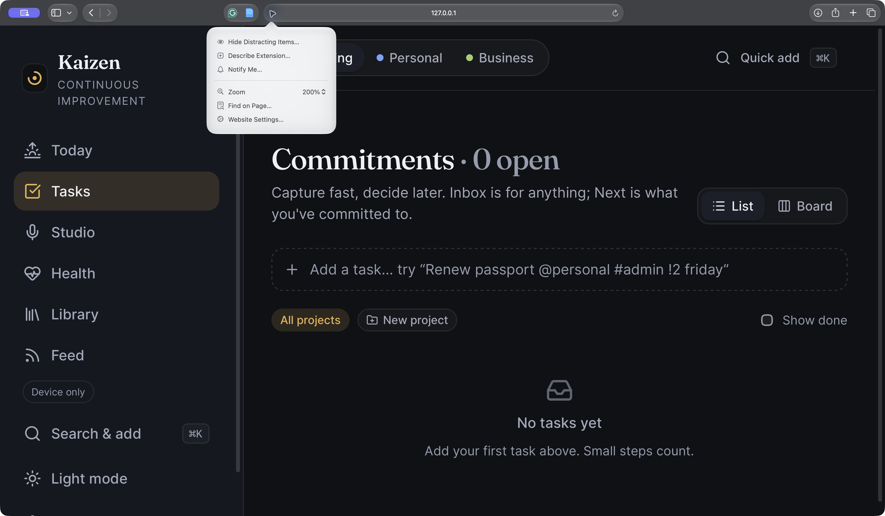
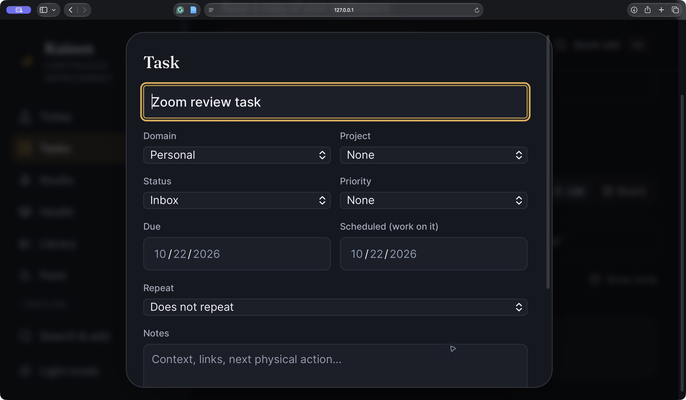
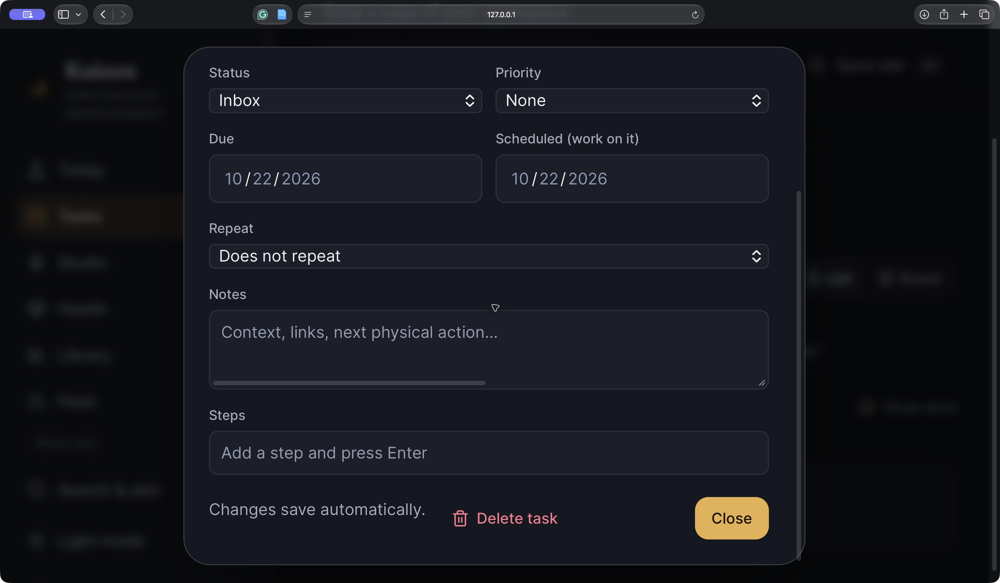

# Remaining issues: scanner cleanup, throttled sync, and native zoom

Review ID: **REV-2026-10-22-RESILIENCE**. Follow-up to [#8](https://github.com/calcuttin/Project-Kaizen/issues/8) and [#18](https://github.com/calcuttin/Project-Kaizen/issues/18); parent roadmap [#1](https://github.com/calcuttin/Project-Kaizen/issues/1).

Base revision: `cc5445b90ad64183621419aa57e6f8ac25f2c44f` (merged/deployed PR #36). This report describes the follow-up branch `codex/remaining-checks-resilience`. Current merge/deployment status belongs in the linked issues. Local testing is not a deployment claim.

Codex inspected the remaining open issues, implemented the fixes, tested them and drafted this record at the maintainer's request. Independent human validation is not claimed. No live account, provider configuration, database schema or backup/recovery resource was changed in this pass.

## Confirmed implementation gaps and fixes

### Scanner lifecycle

Source inspection found that a pending detector result could call the parent after cancellation, a failed video playback could leave camera tracks running until the panel closed, and a throwing detector constructor could escape the effect. The inline result callback also restarted the camera effect whenever the book form rerendered. Previously only the first detected barcode was considered.

The scanner now owns a cancellable session, checks optional format support, handles constructor/permission/playback failures, stops tracks and detaches the video on completion/error/close, and ignores late camera grants or detector results. A callback ref keeps the current form callback without restarting capture on ordinary edits. All detected barcodes are searched for an ISBN-shaped value. Fallback text uses a status region and preserves manual ISBN entry. This does not add ISBN checksum verification.

Unit tests exercise delayed grants, delayed detection, playback rejection, permission denial, unsupported formats/constructor rejection, transient undecodable frames, and a matching ISBN after another barcode. Three browser tests exercise cancellation, form rerenders, cleanup and manual-entry fallback with simulated camera/detector interfaces. They do **not** establish hardware decoding, camera permissions or deployed CSP compatibility. The browser fixture accounts for React development StrictMode's setup/cleanup replay.

Reference: [BarcodeDetector and supported formats](https://developer.mozilla.org/en-US/docs/Web/API/BarcodeDetector).

### Throttled sync

Previously an HTTP 429 became a generic sync failure; later edits could immediately try the API again. There was no shared client cooldown or explicit retry state.

The Supabase client now uses a session-scoped fetch wrapper for its data API. On HTTP 429 it reads a browser-visible `Retry-After` delay or HTTP date, falls back to 60 seconds when absent/invalid/unexposed by CORS, and suppresses further data-API network requests until the deadline. Unrelated endpoints are unchanged. The sync engine preserves the outbox, explains the pause, disables premature manual retries, and schedules another attempt. Switching accounts cancels the old retry and creates a separate client cooldown. Local storage errors still take priority.

Unit tests cover delay/date parsing, fallback, early suppression, deadline recovery, aborts, session separation, retained edits, automatic retry and account-switch cancellation. The cloud browser regression returns a synthetic HTTP 429 with a three-second, CORS-exposed `Retry-After`, then verifies the same mutation payload is retried after the delay, reaches Saved, and the task remains visible. No live load test was performed.

**This is client resilience, not server-side abuse protection.** A modified client can bypass it. Per-account/server request limits, storage/database quotas, cross-tab coordination and production operational enforcement remain open under #18. No provider throttling threshold is inferred from these tests. [Supabase custom-fetch guidance](https://supabase.com/docs/guides/api/automatic-retries-in-supabase-js) describes the supported transport integration.

## Native zoom walkthrough (#8)

The in-app browser shortcut did not change its viewport or pixel ratio. Safari's native controls were used in a separate test window, with synthetic local task data. The native page menu explicitly reported **200%**. The exact saved screenshots below were reopened and inspected before publication; unrelated browser tabs are excluded by using the separate window.

1. **Native 200% page zoom — passed for the inspected task view.** The Tasks controls remain visible and task creation works. This is actual browser zoom, not CSS scaling or viewport emulation.

   

2. **Keyboard task opening and editor — passed.** The synthetic task opens with Space, the title has visible focus, and the editor fits horizontally. Escape restores focus to the task opener in Safari's accessibility state.

   

3. **Lower editor actions — passed.** Vertical scrolling reaches Steps and Close. Controls are not trapped below an unscrollable dialog. Safari was restored to 100% and the test window closed afterward.

   

This is a bounded Tasks/desktop Safari check, not a full zoom/browser/device matrix or screen-reader certification. Native 400% zoom and spoken screen-reader/physical-device checks remain outstanding; the previously verified 320 CSS-pixel reflow is separate evidence. The maintainer has no physical device available.

## Validation

- 84 unit tests passed.
- TypeScript, production build, schema fingerprint and targeted public-source checks passed.
- Initial Today JavaScript measured 177,682 gzip bytes against the 190,000-byte budget.
- 34 device-browser tests and 2 mocked cloud-browser tests passed. PR checks are recorded in the linked roadmap issues.

## Remaining work and explicit deferral

- #8: full spoken OS screen-reader navigation, broader/native 400% zoom, and physical-device checks.
- #18: real camera decode and production custom-auth-domain/CSP checks; server-enforced data-service limits/quotas and intended production controls. The existing identity configuration is development; this pass does not convert it to production.
- **Hosted backup/recovery stays deferred at the maintainer's explicit request.** No backup destination or isolated recovery project is available. No paid plan, backup, restore or new recovery resource was created.
- #1 stays open while its #8 acceptance work is incomplete. Existing dependency update PRs remain separate from these roadmap issues.

Search terms: HTTP 429, Retry-After, throttling, cooldown, outbox, account isolation, barcode, camera cleanup, cancellation, ISBN, Safari, 200 percent zoom, accessibility, deferred recovery.
