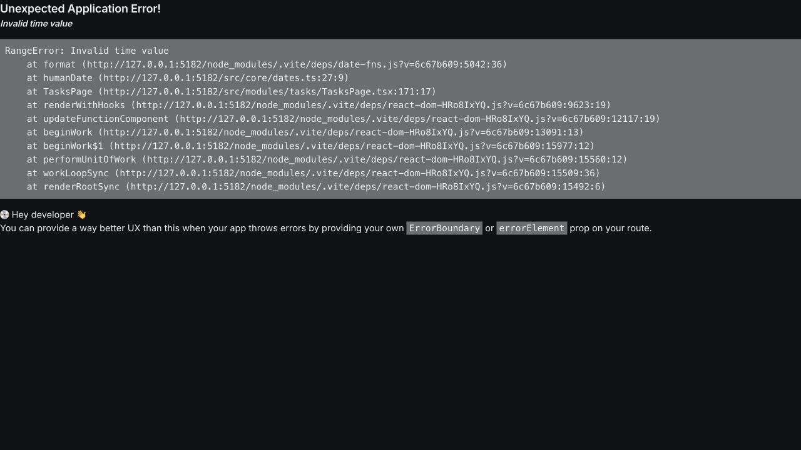
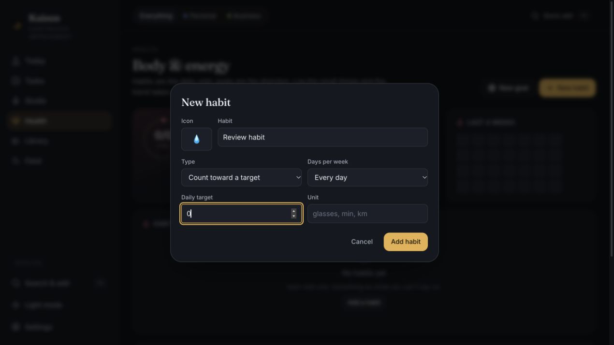
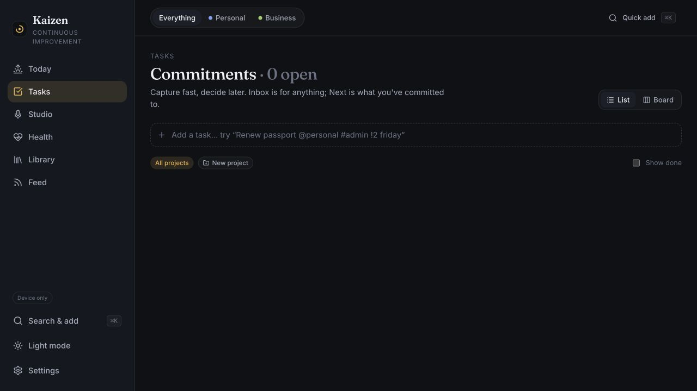
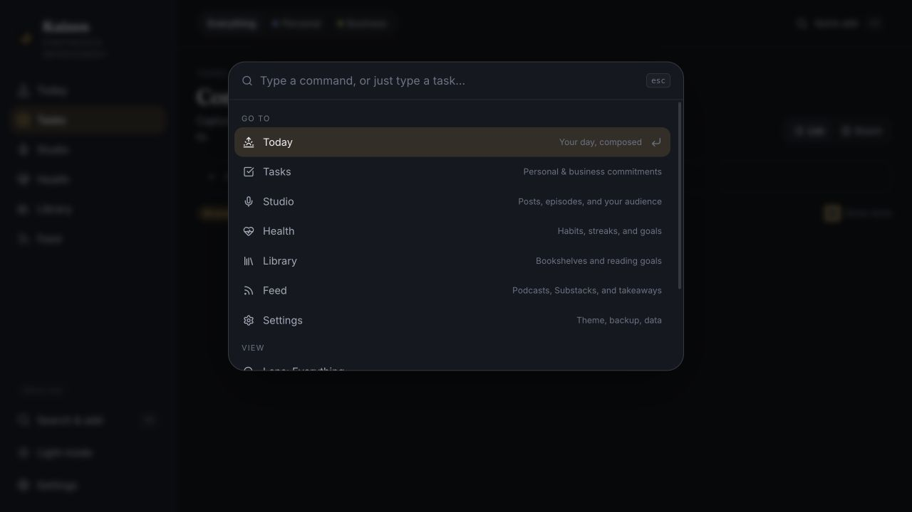
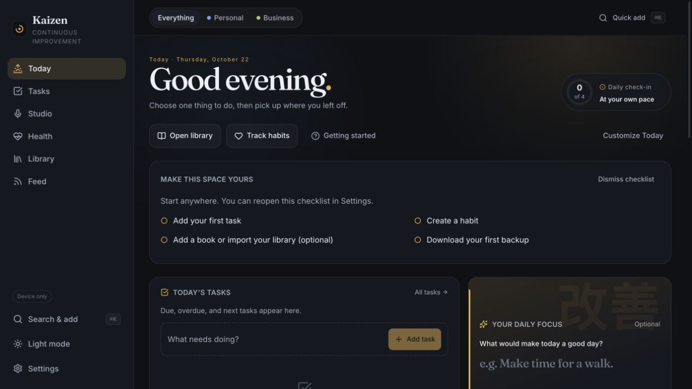

# Security and product review — 2026-10-22

- **Review ID:** REV-2026-10-22-SECURITY-PRODUCT
- **Revision:** `95f552d9a49c26a6cb7d531c16dfa35f1eaad4cc` (main, including project editing in PR #15).
- **Status:** Local review draft; not published to GitHub during this pass. No application fixes included.
- **Attribution:** AI-assisted inspection and verification by Codex at the maintainer's request. No independent human reproduction or approval of conclusions is implied.
- **Keywords:** security, dependencies, privacy, backups, validation, habits, dates, keyboard, accessibility, tasks, search, CSP, account isolation, sync, performance.
- **Environment:** isolated local device-only workspace with synthetic data, desktop browser; read-only public deployment headers and dependency advisory lookup. No personal backups or real account data used.

## Publication follow-up

The original status and observations above describe the review before implementation. The maintainer subsequently authorized fixes and public publication. See the [implementation and verification record](fixes/README.md) for the proposed changes, regression evidence, and remaining deployment checks. Published in [PR #17](https://github.com/calcuttin/Project-Kaizen/pull/17) with follow-up [tracker #18](https://github.com/calcuttin/Project-Kaizen/issues/18). Publication is not independent human validation or deployment approval.

## Recommended order

1. Patch development dependencies; prevent invalid dates and habit targets from entering or breaking the workspace.
2. Repair palette focus and Escape handling; stop queued cover lookups when privacy preferences change.
3. Improve completed-task feedback, record search, habit scoring/editing, and first-use hierarchy.
4. Complete browser-header hardening and deployed cloud verification; reduce the initial bundle and add import resource limits.

P1 means address in the next maintenance cycle; P2 means a planned improvement. These are project priorities, not CVSS scores. No cross-account access or production compromise was demonstrated.

## Security and resilience findings

### S1 — P1: update development dependencies with published advisories

The dependency audit returned **9 advisories: 2 high, 6 moderate, 1 low**. Every finding was marked as a development dependency. A separate production-only audit returned **zero known advisories**; this does not establish that production has no security defects.

| Installed package | Minimum patched version on the installed major line | Evidence |
| --- | --- | --- |
| Vite 8.2.2 | 8.2.4 | [Windows editor-launch issue](https://github.com/advisories/GHSA-587h-7wmj-h5pm), plus five other Vite advisories in the saved audit summary |
| source-map-js 1.2.1 | 1.2.2 | [Source-map processing denial of service](https://github.com/advisories/GHSA-68fv-2mgg-jv7q) |
| @vitest/mocker 4.1.11 | 4.1.12 | [Mock registration code injection](https://github.com/advisories/GHSA-qxg6-89mg-rqv8), plus Windows path handling |

The Windows findings do not imply that this macOS machine is exploitable through those paths. The mocker advisory requires its server plugin to be reachable; installation alone does not establish that exposure. No exploit was attempted. Upgrade compatible Vite/Vitest releases and the lockfile, rerun the full audit and existing checks, and add scheduled dependency monitoring. The checked-in CI has no advisory scan or scheduled update configuration. Edge function npm imports also use floating major versions; pin and audit their resolved dependency graph separately because the frontend audit does not cover them.

Acceptance: affected versions are absent from the resolved graph, build and tests pass, and a scheduled check detects newly disclosed advisories. See [audit-summary.json](audit-summary.json).

### S2 — P1: validate calendar dates before preview, restore, and rendering

**Browser reproduced and isolated test confirmed.** Typing `Review plan 2026-13-01` in Tasks replaces the application with an error before submitting. Reload recovers this unsaved draft. Separately, `inspectBackup` accepts a task with the same invalid due date, and `humanDate` throws a RangeError when rendering it. Persisted malformed data can therefore repeat the failure; this is a workspace availability problem, not a demonstrated account boundary bypass.

Validate real calendar dates and optional date fields at every input boundary. Retain unrecognized quick-add text, show a correction beside the input, make formatters defensive, and provide a recoverable route error screen. Test impossible dates, leap days, incomplete typing, and malformed restored/synced records.

Sources: [quick-add parser](https://github.com/calcuttin/Project-Kaizen/blob/95f552d9a49c26a6cb7d531c16dfa35f1eaad4cc/src/core/parse.ts#L43), [backup validation](https://github.com/calcuttin/Project-Kaizen/blob/95f552d9a49c26a6cb7d531c16dfa35f1eaad4cc/src/core/backupValidation.ts#L55), [formatter](https://github.com/calcuttin/Project-Kaizen/blob/95f552d9a49c26a6cb7d531c16dfa35f1eaad4cc/src/core/dates.ts#L37). Extend existing [issue #2](https://github.com/calcuttin/Project-Kaizen/issues/2) to include restore validation.

### S3 — P1: reject zero/negative habit targets and bound streak traversal

**Form inspected; store/backup acceptance and calculation reproduced in bounded tests.** A count habit's target can be set to zero while Add habit remains enabled. The store and backup validator both accept zero. Given a log object, `habitDone` treats missing days as complete because zero meets a zero target. A guarded test stopped `habitStreak` after it traversed 1,000 missing days instead of terminating. The browser was not deliberately frozen, and the eventual duration of an unguarded calculation was not measured.

Enforce a finite positive target in the form, store, restore, and sync boundaries; require days-per-week in 1–7. Stop streak traversal at missing data or the valid tracking start and add a defensive upper bound. Repair or quarantine previously saved invalid records with an explanation.

Acceptance: zero/negative/non-finite targets cannot be saved or restored, and malformed legacy records cannot block Today or Health. Sources: [habit store and calculations](https://github.com/calcuttin/Project-Kaizen/blob/95f552d9a49c26a6cb7d531c16dfa35f1eaad4cc/src/modules/health/store.ts#L52), [form](https://github.com/calcuttin/Project-Kaizen/blob/95f552d9a49c26a6cb7d531c16dfa35f1eaad4cc/src/modules/health/HealthPage.tsx#L149). New finding; distinct from scoring in #6.

### S4 — P2: cancel queued book-cover lookups when opting out

**Source-confirmed; no third-party requests were exercised.** Cover searches wait in a queue before sending title and author to Open Library. Disabling external covers prevents saving the result, but effect cleanup only changes a boolean; the queued operation still reaches `fetch` without rechecking consent. Several queued searches can therefore continue after opt-out.

Cancel queued work and abort active requests when the preference changes, the workspace locks, or the owner changes. Check consent and owner immediately before transmission, not only before storing results. Already-sent requests cannot be retracted.

Acceptance: with a synthetic library and mocked network, turn covers off while multiple lookups wait; no remaining queued request starts and in-flight requests are aborted. Source: [queue and effect cleanup](https://github.com/calcuttin/Project-Kaizen/blob/95f552d9a49c26a6cb7d531c16dfa35f1eaad4cc/src/modules/library/BookCover.tsx#L55).

### S5 — P2: complete deployment hardening and import limits

**Header/source inspection; hardening recommendations, not proven exploits.** The public Vercel response has HSTS, nosniff, framing protection, a referrer policy, and a partial CSP. Its CSP only restricts framing, objects, and base URLs; it does not restrict script or connection sources. Introduce an explicit policy with report-only validation first, covering Clerk, Supabase, optional covers, camera flows, and the service worker. Bring equivalent headers to the checked-in self-hosted nginx configuration, which currently only sets cache headers.

JSON backup import has a 50 MB limit. Library CSV/text imports read and parse the entire file without a comparable size check or local read-error handling. Add byte/record limits, clear errors, cancellation, and worker-based parsing for large supported imports; avoid quadratic deduplication when scaling libraries.

Sources: [Vercel headers](https://github.com/calcuttin/Project-Kaizen/blob/95f552d9a49c26a6cb7d531c16dfa35f1eaad4cc/vercel.json), [nginx](https://github.com/calcuttin/Project-Kaizen/blob/95f552d9a49c26a6cb7d531c16dfa35f1eaad4cc/docker/nginx.conf), [ImportCenter](https://github.com/calcuttin/Project-Kaizen/blob/95f552d9a49c26a6cb7d531c16dfa35f1eaad4cc/src/modules/library/ImportCenter.tsx#L28).

## Product findings and roadmap mapping

| Priority | Finding and evidence | Recommended outcome | Existing work |
| --- | --- | --- | --- |
| P1 | Palette focus escapes to Show done after Shift+Tab; Escape then does nothing. Reproduced this pass. | Contain focus, make background inert, handle Escape for the whole dialog, restore trigger focus. | [#3](https://github.com/calcuttin/Project-Kaizen/issues/3) |
| P2 | Completing the only task leaves a blank list. Reproduced this pass. | Show “All caught up” and a Show completed action; apply completed filtering consistently to Board. | [#4](https://github.com/calcuttin/Project-Kaizen/issues/4) |
| P2 | Palette builds commands and creation actions rather than searching saved records. Current source rechecked; prior browser evidence retained. | Search tasks, books, feed items, and publishing pieces; rank existing records before creation. | [#5](https://github.com/calcuttin/Project-Kaizen/issues/5) |
| P2 | Habit score still includes days before creation, and habit rows lack edit/archive controls. Current source rechecked. | Score eligible days, respect weekly schedules, and preserve history when changing habits. | [#6](https://github.com/calcuttin/Project-Kaizen/issues/6), [#7](https://github.com/calcuttin/Project-Kaizen/issues/7) |
| P2 | Today has useful guidance, but the large setup card pushes task capture down at the captured desktop height. Visual observation. | Compact setup progress and make the first daily task the primary action. | [#9](https://github.com/calcuttin/Project-Kaizen/issues/9) |
| P2 | Production build still produces an 822.03 kB main JS chunk, 238.13 kB gzipped. | Split routes and defer heavy import/optional features; measure first-load performance. | [#12](https://github.com/calcuttin/Project-Kaizen/issues/12) |

Project editing has shipped in [PR #15](https://github.com/calcuttin/Project-Kaizen/pull/15), addressing [#14](https://github.com/calcuttin/Project-Kaizen/issues/14). Recurring tasks already have [issue #16](https://github.com/calcuttin/Project-Kaizen/issues/16); prioritize a clear repeat rule, completion behavior, and skip/pause controls after the reliability fixes. Do not create duplicate issues for the September review. Mobile, screen-reader behavior, and full Library/Studio/Feed journeys were not re-audited in this pass.

## Security strengths and remaining verification

The reviewed code scopes browser caches by owner, locks and reloads the workspace on account changes, binds access-token resolution to the current session, and applies owner-based database/storage policies. Backup inspection validates all stores before mutation and rejects unsafe object keys. The service worker excludes authorization-bearing requests and API/auth paths. Existing recovery and isolation tests are useful safeguards.

These source checks do not prove the live database matches the migrations. Before broader cloud release, verify deployed policies and RPC permissions with two controlled accounts, expired/revoked sessions, and storage access. Existing cloud browser tests use mocked authentication/backend responses. Run the database policy suite separately; it was not run during this review.

Also add controlled tests for simultaneous edits to one record and account deletion during active sync. The sync SQL reads a revision before an unconditional upsert, so atomic conflict detection deserves explicit concurrency verification. Account deletion spans storage, tables, and the auth provider; verify that retries and concurrent writes cannot leave data behind. These are source-review follow-ups, not reproduced deployed failures. Verify operational rate limits, monitoring, backup restoration, and production auth configuration separately.

## Verification record

- Existing unit suite: **15 files / 40 tests passed**.
- Schema/type consistency check and targeted public-source check: **passed**. The latter is not a comprehensive secret scan.
- Production build: **passed**, with the bundle-size warning recorded above.
- Dependency audit: **9 development advisories**; production-only audit: **0**.
- Temporary bounded reproduction suite: **3 tests passed**, confirming the date and zero-target behaviors. These deliberately assert the present defects; they are not regression tests proving fixes. Exact probe saved as [validation-probe.test.ts.txt](validation-probe.test.ts.txt); removed from the application's test directory after execution.
- Browser: Today first-use, habit target input, task creation/completion, invalid quick-add date, reload recovery, and palette keyboard focus checked with synthetic data. Exact saved screenshots inspected.
- No production write, account deletion, destructive load test, exploit attempt, real multi-account authorization test, or full E2E/database run performed.

This report records review evidence and proposed acceptance criteria. Public issue creation, implementation, and follow-up verification remain separate steps.

## Follow-up implementation

The maintainer subsequently authorized fixes. See the [implementation and verification record](fixes/README.md) for changes, screenshots, test results and deployment limits. The observations above remain the original pre-fix findings.
