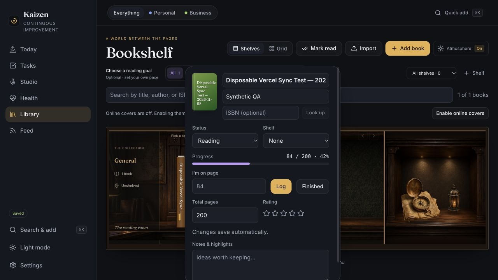

# Full Kaizen and Bookshelf on Vercel

Review ID: **REV-2026-11-08-VERCEL-BOOKSHELF**. AI-assisted release work by Codex at the maintainer's request, November 8, 2026 (America/New_York).

## Release

PR #39 merged first at `700f590b08b1ea0dea5100828dd63636bb8096db`. PR #41 was retargeted from the dependency branch to main, marked ready, checked, and merged at `5ebc4e785ced7ef22c352b8b74a74a1bf2773829`. All reported checks passed before each merge. The latter merged revision also passed web/database CI, container/edge verification, and CodeQL Actions and JavaScript/TypeScript analyses.

| Experience | Production URL | Vercel deployment | Application revision |
| --- | --- | --- | --- |
| Full Kaizen | https://project-kaizen-gamma.vercel.app | `dpl_5hSyCp3ZbB4UFA5yYVmmgVpsrA5R` | `5ebc4e785ced7ef22c352b8b74a74a1bf2773829` |
| Bookshelf | https://kaizen-bookshelf.vercel.app | `dpl_BbrtpvFER1kxpVsLJ9AK4DHq9tDr` | `5ebc4e785ced7ef22c352b8b74a74a1bf2773829` |

Vercel reports both production deployments Ready and assigns the domains above. Both projects connect to `calcuttin/Project-Kaizen`, root directory, production branch `main`, Vite preset, and Node 24. Bookshelf's new-project default Node version was changed to the tested Node 24 configuration before deployment.

## Configuration and bounded verification

- Both compiled applications contain the same Clerk publishable key, Supabase URL and Supabase publishable key, checked without publishing their values. No secret or service-role key is supplied to the frontend.
- Bookshelf sets `VITE_KAIZEN_PRODUCT=bookshelf`; the main project defaults to Full Kaizen. Both use cloud mode. Bookshelf uses normal browser routing on Vercel (`VITE_KAIZEN_HASH_ROUTING=false`) and the repository's deep-link rewrites/security headers.
- Both `/library` and `/settings` return HTTP 200. The Bookshelf sign-in page renders with Bookshelf selected by default.
- No database migration, new identity application, or separate library database was created.
- The earlier Sites deployment is retained during the move. Its browser-only prototype data remains on its original origin; moving hosts does not transfer local storage automatically. Export that library there before retiring the old origin. Account-synced books use the shared database.
- Live account sync passed using one explicitly authorized disposable development identity. The bounded test and cleanup are recorded below.

## Authenticated two-way sync

1. Created one disposable Clerk development account and signed into both Vercel origins through their email-code sign-in flows. No existing user directory was enumerated.
2. Created the synthetic 200-page book **Disposable Vercel Sync Test — 2026-11-08** in Bookshelf with status Reading. It appeared in Full Kaizen under the same account.
3. Logged page 42 in Full Kaizen. After saving and synchronizing, Bookshelf displayed **42 / 200 · 21%**.
4. Logged page 84 in Bookshelf, waited for Saved, and reloaded Full Kaizen. It displayed **84 / 200 · 42%** with Saved status. This demonstrates book creation and reading-progress synchronization in both directions across separate origins.
5. Called the deployed account-deletion endpoint using only this disposable account's session. It returned HTTP 200 with `deleted: true`. A lookup of that exact Clerk user returned 404; the account had zero active sessions. Both apps returned to their signed-out welcome screens after reload.

The app's deletion endpoint removes owned application rows and import files before deleting the Clerk identity; successful completion was observed. This test did not independently query privileged database row counts. The intentional deletion tombstone remains part of the deletion guard. No existing account or personal data was changed.

This is synchronized saving, not an instantaneous push guarantee: the client polls every 60 seconds and also syncs on visibility changes or Save now. Reading the other origin before the save/pull completes can show the previous page. No application defect was established in this test. Notes, experience-preference propagation and additional browsers/devices were outside this bounded check; a proposed note write was rejected by automatic approval review before execution because the authorization covered books/progress.

## Limits

The existing Clerk instance is still a development instance. Production identity/domain setup remains separate work. The existing Safari account showed pending sync conflicts before this verification; no personal conflict resolution or record overwrites were authorized or performed. Naming and native iPhone sync remain separate work. Physical-device accessibility testing remains unverified. **Hosted backup/recovery remains deferred.**

[Implementation review](../shared-bookshelf-account.md) · [Roadmap tracker #18](https://github.com/calcuttin/Project-Kaizen/issues/18)
